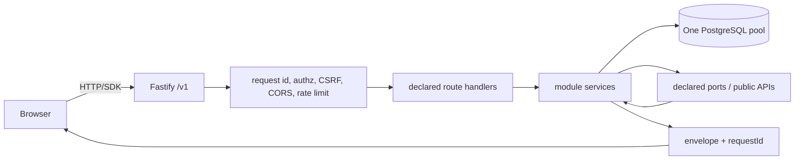

# Architecture

This describes the verified implementation as of the 2026-11-27 research snapshot. Re-check source before relying on volatile details such as commit hashes or dependency versions.

## Workspace layout

```text
packages/core                 config, database, modules, api, security
packages/module-users         identity, profiles, roles, permissions
packages/module-auth          sessions, login, CSRF, password reset
packages/module-catalog       generic items, cursor API, extension ports
packages/module-products      product details and price resolver
packages/module-inventory     stock reservation port
packages/module-orders        idempotent orders, immutable snapshots
packages/app-composition      checked-in M8 static wiring and migrations
packages/sdk                  generated types + thin fetch client
apps/demo-ecommerce           separate Fastify API + Vite storefront
examples/frontend-*           vanilla and React SDK examples
openapi/                      committed public OpenAPI artifact
tests/regression/             cross-cutting invariant tests
docs/                         architecture, API, security, release, QA docs
scripts/                      start, migrate, cleanup, artifact generation
```

`pnpm-workspace.yaml` includes `templates/*`, but no such directory exists in the current tree.

Core public subpaths: `.`, `./api`, `./config`, `./database`, `./modules`, `./security`. The SDK exposes one root entrypoint and has zero runtime dependencies. All packages/apps are private and version `0.1.0`.

## Module contract and registry

`ModuleDefinition` declares `id`, `version`, `stability`, `requires`, `enhances`, `provides`, `consumes`, config schema, permissions, `register()`, and optional `publicApi`. `composeModuleRegistry()` accepts an explicit checked-in list; there is no disk discovery.

The frozen `ModuleContext` exposes config, app config, database, scoped permission/route registrars, `use()` for declared hard dependencies, and `port()` for declared consumed ports. Undeclared dependencies, missing/ambiguous ports, version mismatches, missing port APIs, and cycles fail during graph validation.

Verified module graph:

| Module | Hard `requires` | Provides | Consumes |
|---|---|---|---|
| `users` | — | public API | — |
| `auth` | `users` | `buyer-context@1` | — |
| `catalog` | — | public API | — |
| `products` | `catalog` | `price-resolver@1` | — |
| `inventory` | `catalog` | `inventory@1` | — |
| `orders` | `auth`, `users`, `catalog` | public API | required `buyer-context@1`; optional `price-resolver@1`, `inventory@1` |
| demo `cart` | `catalog`, `products`, `orders` | public API | `buyer-context@1` |

Port IDs are mirrored as strings across modules to avoid implementation coupling. Catalog owns generic port contracts (`PriceResolverPort`, `InventoryPort`, money/context/snapshot types). Orders depends on auth/users in the module graph but imports only public APIs injected by composition.

## Static composition and startup

`createM8Composition()` builds users, auth, catalog, products, inventory, and orders, plus optional `additionalModules`. It:

1. Rejects multiple enabled price resolvers before listen with `AMBIGUOUS_PRICE_RESOLVER`.
2. Requires buyer binding when orders are enabled.
3. Activates the registry from explicit definitions.
4. Rebuilds orders with resolved optional price/inventory APIs.
5. Filters route handlers to the activation report.
6. Returns registry, activation report, route handlers, authenticator, CSRF guard, and public APIs.

`additionalModules` is for applications declaring their own static providers; it is not plugin discovery. Startup loads config, initializes the database, composes modules, creates one Fastify server, installs graceful shutdown, and listens. Composition failures happen before listen.

## Request/data flow



The demo cart is app-local: its routes use `buyer-context@1`, never accept a buyer ID from the client, resolve prices server-side, and checkout snapshots cart lines into shared orders with an idempotency key.

## API contract

- One Fastify instance; `/v1` for all business routes.
- Request IDs: `req_<uuid>`, returned as `x-request-id`.
- Success: `{ data, meta: { requestId, nextCursor? } }`.
- Error: `{ error: { code, message, details?, requestId } }`.
- Global deny-by-default permission guard: missing principal → `401`, missing permission → `403`.
- CSRF preHandler runs on `POST`, `PUT`, `PATCH`, `DELETE` when a guard is supplied; cookie sessions are challenged, bearer clients are intentionally exempt.
- Exact-origin CORS only; wildcard with credentials is rejected; no configured origins means no cross-origin headers.
- Global per-process rate limit, plus stricter auth route limits.
- `/health/live` and `/health/ready` are unprefixed and excluded from public OpenAPI.
- `/v1/config/public` is an allowlist: `appName`, `apiBaseUrl: '/v1'`, `authMode: 'session'`, enabled module IDs.
- Committed public OpenAPI contains 21 operations across 14 paths. Generated artifact checks compare exact bytes.

Consumers must not add health/private config to public OpenAPI or hand-edit generated files.

## Database architecture

- Core owns one `Database` singleton: `initializeDatabase()`, `getDatabase()`, `closeDatabase()`, `db`, `transaction()`, `health()`, `migrate()`. Modules do not create pools.
- Initialization runs `SELECT 1`; health maps failures to `DATABASE_UNAVAILABLE` or `DATABASE_NOT_INITIALIZED`.
- Migrations run under advisory lock `(1934793174, 1)` and report applied/up-to-date by comparing migration counts.
- Core baseline migration intentionally contains no application tables.
- M8 migration order: core → users → auth → catalog → products → inventory → orders. Demo adds its cart migration after shared migrations.
- Each module owns a Drizzle config and migration folder. Future migrations are appended and reviewed; production must not auto-migrate on startup.
- Important constraints: unique user email, unique catalog slug, unique SKU, non-negative prices/stock, unique `(buyer_ref, idempotency_key)`, buyer kind `user`, confirmed order status, and immutable order-line snapshots.

Orders idempotency is transaction-scoped: insert pending record; same hash returns the original order; different hash returns `IDEMPOTENCY_CONFLICT`; pending conflict returns `CONFLICT`. Prices are server-authoritative and line details are snapshotted at creation.

## Configuration

Precedence: process environment → `.env.local` → `.env` → `skeleton.config.ts` → defaults. Config file names searched include `skeleton.config.ts`, `.mts`, `.cts`, `.js`, and `.mjs`.

`loadConfig()` aggregates env/config/Zod issues into one `ConfigError` before startup. Secrets come from `env(...)`; literal `database.url` values are rejected. Startup summaries are redacted.

Notable defaults: app `SkeletonStructure`, development env, server `0.0.0.0:3000`, DB pool max 10, JSON logs with redaction, `skel_session` httpOnly cookie, CSRF enabled, exact-origin CORS with credentials, global rate limit 100/60s, all modules disabled, password minimum 12, idempotency key required, console email provider.

Production validation requires secure cookies, JSON logs, CSRF enabled, no wildcard CORS with credentials, and protected redaction defaults.

## Extensibility and integration patterns

- **Module APIs**: use `publicApi` and declared ports; never import another module's internals.
- **App-local additions**: pass static providers in `additionalModules`; declare their own migrations, routes, permissions, and public APIs.
- **Catalog extensions**: expansion providers keyed by `kind`; domain extensions own their tables and snapshots.
- **Optional capabilities**: `price-resolver@1` and `inventory@1` are consumed only when declared and unambiguously provided.
- **Readiness**: injected `ReadinessCheck` seam exists; default startup does not pass a migration check.
- **Clients**: shared SDK for public routes; app-local generated client for app-only routes.
- **Artifacts**: deterministic generators/checks for OpenAPI, SDK types, demo client, and config reference.

## Deployment considerations

- Demo API runs on `127.0.0.1:3000`; Vite dev server on `http://127.0.0.1:5173`; CORS must name the exact frontend origin.
- Health endpoints support liveness/readiness probes.
- Production guidance: least-privilege DB role, `NODE_ENV=production`, `COOKIE_SECURE=true`, `DATABASE_SSL=true`, exact `CORS_ORIGINS`, managed secrets and TLS, explicit migrations.
- No production deployment manifests or fork-upgrade procedure are verified in the repository.
- Applications should own their database and deployment rather than share one with the foundation or another application.
